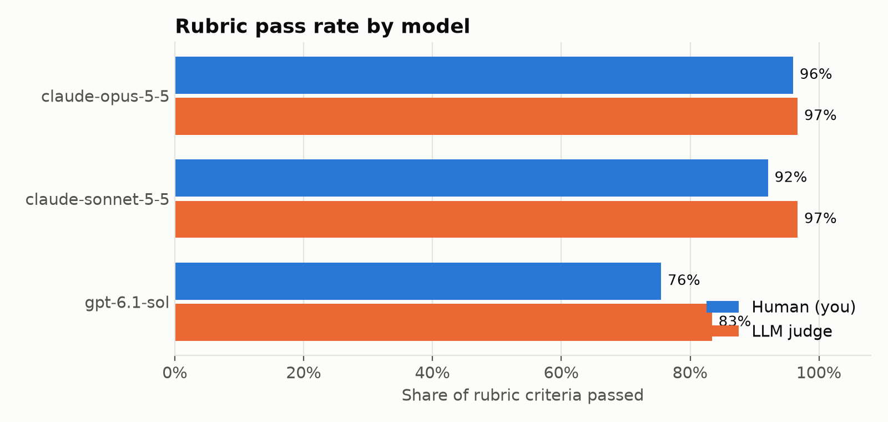
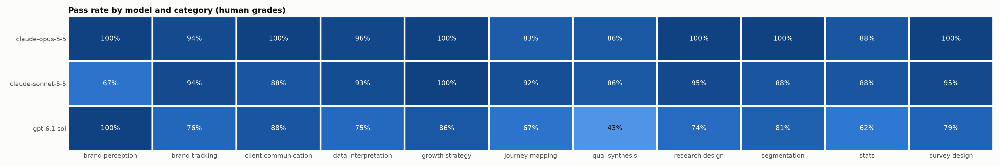
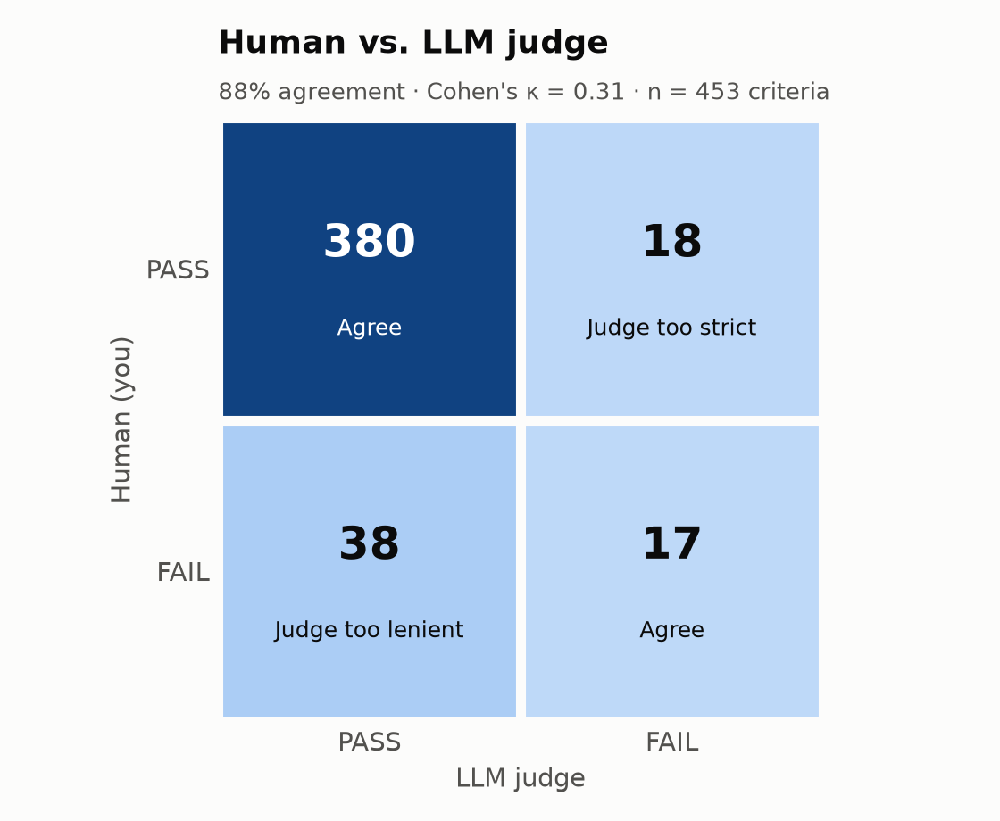

# Consumer Insights LLM Eval

A small, expert-built evaluation of how well frontier LLMs handle **consumer insights and brand strategy** work: survey design, segmentation, customer journey mapping, brand tracking, and interpreting research data.

Each task comes with a rubric of 3–5 **pass/fail criteria** written by a domain expert, targeting the details a seasoned insights professional checks and a generalist misses (e.g. *"identifies that unaided awareness must be asked before the aided brand list"*). Responses are graded twice:

1. by an **LLM judge**, blind to which model wrote the response, and
2. by a **human expert** (me), also blind, in a purpose-built grading app.

Comparing the two shows how far an automated judge can be trusted in this domain, and where it fails.

## Headline results

41 tasks × 3 models = 123 responses, 453 rubric criteria, each graded by both me and the judge.

| Model | Human pass rate | Judge pass rate | Responses with every criterion passed (human) |
|---|---:|---:|---:|
| Claude Opus 5.5 | **96%** | 97% | 36 / 41 |
| Claude Sonnet 5.5 | **92%** | 97% | 29 / 41 |
| GPT-6.1 Sol | **76%** | 83% | 14 / 41 |

- **The judge misses most real failures.** Of the 55 criteria I failed, the judge also failed 17 (31%). It agrees with me on 88% of all criteria, but because nearly 9 in 10 criteria pass, much of that is chance agreement: **Cohen's κ = 0.31** (fair).
- **The judge can't separate the two Claude models.** It gives Opus and Sonnet identical scores (97%); my grades put Opus 4 points ahead. It does preserve the large gap to GPT-6.1 Sol, but understates it.
- **No sign of self-preference.** The Claude judge was more lenient than me on every model, and *most* lenient on GPT-6.1 Sol (+8 points vs +1 for Opus).
- **Most disagreements trace back to rubric wording, not judge reasoning.** The judge grades what a criterion says; I grade what I meant by it. See [Where the judge and I disagree](#where-the-judge-and-i-disagree).



## Pipeline

```
data/prompts.yaml ──► run_models.py ──► results/responses.csv
                                              │
                         ┌────────────────────┴────────────────────┐
                         ▼                                         ▼
                     judge.py                                grade_app.py
              results/judge_scores.csv                results/human_scores.csv
                         └────────────────────┬────────────────────┘
                                              ▼
                                         analyze.py
                       summary tables · agreement + Cohen's κ · disagreements · charts
```

| File | What it does |
|---|---|
| `data/prompts.yaml` | Tasks and rubrics (`id`, `category`, `prompt`, `rubric: [{id, criterion}]`) |
| `config.yaml` | Models under test, judge model, output length |
| `run_models.py` | Sends every prompt to every model; saves `results/responses.csv` |
| `judge.py` | LLM judge scores each response on each criterion (PASS/FAIL + one-line reason) |
| `grade_app.py` | Streamlit app for blind human grading, one response at a time |
| `analyze.py` | Pass rates by model and category, human–judge agreement, disagreement list, charts |
| `src/llm.py` | Shared helper that calls the OpenAI and Anthropic APIs |

## Setup

Requires Python 3.10+.

```bash
python3 -m venv .venv            # create an isolated Python environment (once)
source .venv/bin/activate        # activate it (every new terminal)
pip install -r requirements.txt  # install libraries (once)
```

Create a `.env` file with your API keys (it is git-ignored):

```
OPENAI_API_KEY=...
ANTHROPIC_API_KEY=...
```

## Running

```bash
python run_models.py         # 1. collect responses
python judge.py              # 2. LLM judge
streamlit run grade_app.py   # 3. grade blind in the browser (Ctrl+C to stop)
python analyze.py            # 4. tables, agreement, charts
```

Steps 1 and 2 are safe to re-run: finished work is skipped and failed calls are retried. The grading app saves after every response, so you can stop and resume. Don't regenerate responses after grading has started: new responses get new IDs, and existing human grades will no longer match them.

## Methodology

- **Tasks:** 41 tasks across 11 categories, written from my experience in consumer insights. All companies and figures are invented. Most tasks contain a specific trap an expert would catch: Simpson's paradox in a pack test, aided awareness asked before unaided, surveying active subscribers to learn why customers churn, reading significance into a 1-point tracker move.
- **Models:** Claude Opus 5.5, Claude Sonnet 5.5, OpenAI GPT-6.1 Sol (see `config.yaml`). Every model gets the identical prompt with no system prompt, and reasoning effort is set to `high` for all of them so no model is held back by its provider's default. Max output is 16,000 tokens; no response was cut off.
- **Judge:** Claude Opus 5.5 at `high` effort. It gets the task, the response, and the rubric, but never the model name. It writes its reason before its verdict, it must PASS only when a criterion is clearly and explicitly met, and its output is constrained to a JSON schema so every verdict parses.
- **Human grading:** responses are shown in a fixed shuffled order with model names and judge verdicts hidden.
- **Metrics:** pass rate = share of rubric criteria passed. Human grades are treated as ground truth. Agreement is reported as raw % and as **Cohen's κ**, which corrects for agreement expected by chance (important when most criteria pass).

## Results

### By category



Claude Opus 5.5 scored 100% (human) in six of eleven categories. GPT-6.1 Sol's weakest areas were qualitative synthesis (43%), stats (63%) and journey mapping (67%). Several categories have only 1–3 tasks, so treat individual cells as indicative. Full table: `results/summary_by_model_category.csv`.

GPT-6.1 Sol's answers were less than half as long as Opus's (~755 vs ~1,800 output tokens on average). Many of its failures are points it raised in a single clause without developing them, or left out entirely.

### Human vs. judge



| Group | Criteria | Agreement | Cohen's κ | Human pass | Judge pass |
|---|---:|---:|---:|---:|---:|
| All | 453 | 88% | 0.31 | 88% | 92% |
| Claude Opus 5.5 | 151 | 95% | 0.34 | 96% | 97% |
| Claude Sonnet 5.5 | 151 | 91% | 0.20 | 92% | 97% |
| GPT-6.1 Sol | 151 | 76% | 0.28 | 76% | 83% |

Agreement was weakest in survey design, segmentation and brand tracking, where κ is close to zero. Per-category figures: `results/agreement.csv`.

### Where the judge and I disagree

There were 56 disagreements: in 38 the judge passed a criterion I failed, and in 18 it failed one I passed. Claude sorted them by the kind of mistake (full list: `results/disagreements.csv`):

| Pattern | Count | Example |
|---|---:|---|
| **Judge too lenient** | **38** | |
| Credits a point mentioned in passing that the response never develops | 14 | One sentence that targeting "may select people who already had higher purchase intent" passed as identifying selection bias |
| Same criterion failed by me across 2–3 models: I held a bar the criterion doesn't state | 11 | "Warns that repositioning risks giving up existing strengths" (BT06) |
| Counts any item from an "e.g." list, or something nearby, instead of the core requirement | 10 | "Check other data" accepted where pooling waves or boosting the sample was the point |
| Passes a hedged conclusion as a conclusion | 2 | "Neutral-to-positive" passed as "concludes the new pack performed better" |
| Treats a conditional criterion as passed when it doesn't apply | 1 | "If recommending sequential monadic…" passed when it wasn't recommended |
| **Judge too strict** | **18** | |
| Demands specific wording when the substance is there | 9 | "Unreliable" not accepted for "stated willingness-to-pay overstates real behavior" |
| Fails a hedged recommendation as no recommendation | 8 | "Review speeders, don't auto-drop" failed "recommends removal" (all three models) |
| Fails a two-part criterion when one part is thin | 1 | Qual interviews recommended, but no quant sizing step |

**What this suggests:** 22 of the 56 (the unstated bar, "e.g." lists, and the conditional criterion) are problems with the rubric rather than the judge, and can be fixed by rewriting criteria. The rest point to two judge instructions worth testing: a depth rule ("a passing mention is not enough; the point must be explained or applied") and an explicit rule for hedged conclusions. In some cases the hedged answer is better practice than the criterion. Saying a +2-point lift on 200 shoppers is "neutral-to-positive" is more careful than declaring the new pack better.

## Limitations

- **Single human rater:** human grades are treated as ground truth, but some disagreements may be my own inconsistencies (e.g. hedged conclusions passed in some tasks and failed in others). There is no inter-annotator agreement yet.
- **Ceiling effects:** in 13 of 41 tasks every model passed every criterion. These tasks don't separate models and inflate raw agreement.
- **Small sample:** 41 tasks × 3 models, with several categories at 1–3 tasks. The ~20-point gap between Claude and GPT-6.1 Sol is large; the 4-point Opus–Sonnet gap is not statistically meaningful at this size.
- **Self-preference risk:** the judge is a Claude model and two of the three contestants are Claude models. In this run the judge was most lenient toward the non-Claude model, but one judge and one run can't rule out bias.
- **Imperfect blinding:** writing style, length and formatting can hint at which model wrote a response.
- **One run per model:** model outputs vary from run to run, so results reflect a single sample per task.

## Next steps

1. Rewrite the criteria behind the 22 rubric-driven disagreements, separating required points from examples and adding an N/A option for conditional criteria.
2. Add a depth rule and a hedging rule to the judge prompt, and re-run the judge to measure the change in κ.
3. Drop or harden the 13 tasks every model aced, then cut the set to ~25 discriminating tasks.
4. Add a second human grader to measure human–human agreement as a ceiling for the judge.
